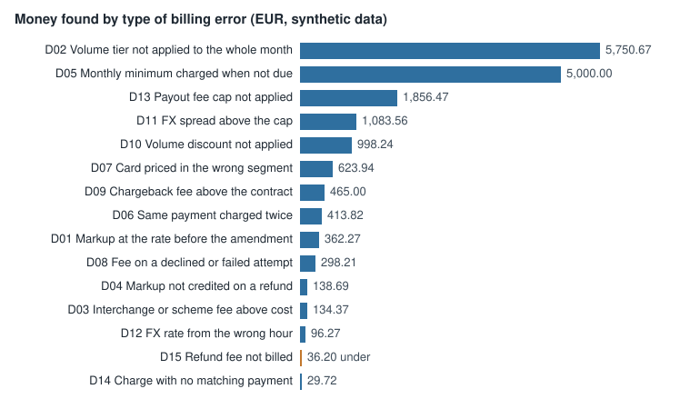
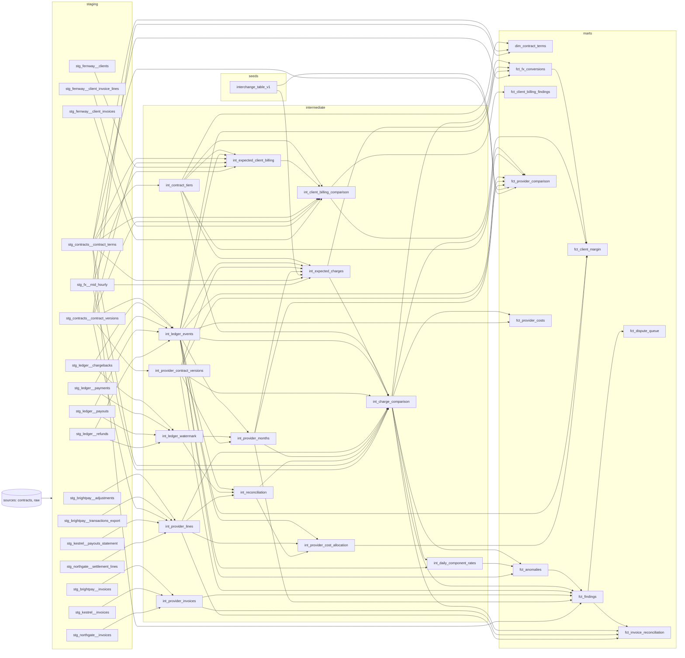

# payments-fee-audit

Checks every fee a payments company pays its providers, and every invoice it sends its own clients, against the contracts behind them, line by line, and turns the differences into numbers a finance team can act on: a findings summary, dispute packs per invoice, a monthly cost report, a provider comparison and a client report with revenue leakage and margin.

Everything runs on fully synthetic, seeded data. Fernway, its clients and its providers are fictional; the contracts and rates are illustrative, not anyone's real pricing. Because the data is generated, every planted billing error is known and the checks can be scored against it. Every number in this README is written by `make report` from the warehouse; the text around the numbers is hand-written.

## The problem

A payments company pays its acquirers and payout providers thousands of small fees a month: interchange and scheme fees passed through at cost, a markup that depends on monthly volume, fixed fees, refund and chargeback fees, FX spreads and payout fees. Each is set by a contract clause, with amendments, tiers, caps and rounding rules. Invoices are usually checked by total, not line by line, so overcharges of a few cents per payment add up unnoticed until the dispute window has closed. This project recomputes every charge from the contract and the internal ledger and reports each difference with its evidence.

<!-- generated:headline -->
From 2026-01 to 2026-06, 18,230 provider charges differ from the contracts: EUR 17,251.23 overcharged and EUR 36.20 undercharged. As of 2026-07-15, EUR 4,320.13 can still be disputed on 5 open invoices (M07); EUR 12,931.10 is past its dispute deadline. A further 305 one-cent rounding differences (EUR 3.05 net) are reported but not disputed.


<!-- /generated -->

## The world

Fernway is a fictional payments company. It processes card payments for its clients through two acquirers, Northgate (interchange and scheme fees at cost plus a tiered markup) and Brightpay (one blended rate per card segment), and pays out to clients through Kestrel (payout fees and FX conversion). Contracts are versioned YAML files under `contracts/`; an amendment in the middle of the period changes some rates. The generator writes the internal ledger, each provider's exports and invoices in their own formats and quirks, and plants billing errors of known types, amounts and lines. The data is synthetic because real provider statements are confidential, and because only planted errors give a ground truth to score against.

<!-- generated:world -->
Ledger: 397,608 payments, 10,211 refunds, 757 chargebacks, 59,557 payouts for 40 clients, 2026-01-01 to 2026-06-29; 1,248,256 provider lines to check.

| Provider | Contract | Version | In force | Dispute window | Clauses |
|---|---|---|---|---|---|
| Brightpay | BP-2025-07 | 1 | 2025-07-01 to open | 30 days | 3.1 All-in fee per payment by card segment; no fee on declined or failed attempts; 3.4 Marginal volume discount on EEA consumer cards, settled monthly; 5.2 Refund fee; the original fee is not credited; 6.3 Chargeback fee |
| Kestrel Payouts | KP-2025-09 | 1 | 2025-09-01 to 2026-03-31 | 45 days | 2.1 SEPA payout fee; 2.2 Faster Payments payout fee; 2.3 SWIFT payout fee, a share of the EUR equivalent at mid, with a minimum and a cap; 4.1 FX spread cap against the hourly mid rate at the execution hour |
| Kestrel Payouts | KP-2025-09 | 2 | 2026-04-01 to open | 45 days | 2.1 SEPA payout fee; 2.2 Faster Payments payout fee; 2.3 SWIFT payout fee, a share of the EUR equivalent at mid, with a minimum and a cap; 2.4 Elixir payout fee; 4.1 FX spread cap against the hourly mid rate at the execution hour |
| Northgate Acquiring | NG-2025-01 | 1 | 2025-07-01 to 2026-03-31 | 60 days | 3.1 Interchange and scheme fees at cost; 4.2 Acquirer markup by monthly processed volume; 4.3 Fixed fee per successful payment; 5.1 Refund fee and credit of the original markup; 6.1 Chargeback handling fee; 7.4 Monthly minimum markup |
| Northgate Acquiring | NG-2025-01 | 2 | 2026-04-01 to open | 60 days | 3.1 Interchange and scheme fees at cost; 4.2 Acquirer markup by monthly processed volume; 4.3 Fixed fee per successful payment; 5.1 Refund fee and credit of the original markup; 6.1 Chargeback handling fee; 7.4 Monthly minimum markup |

Planted billing errors (counted from the generator's truth by the evaluation step):

| Type | Error | Planted | Money (EUR) |
|---|---|---:|---:|
| D01 | Markup at the rate before the amendment | 15,091 | 362.27 |
| D02 | Volume tier not applied to the whole month | 2 | 5,750.67 |
| D03 | Interchange or scheme fee above cost | 771 | 134.37 |
| D04 | Markup not credited on a refund | 538 | 138.69 |
| D05 | Monthly minimum charged when not due | 2 | 5,000.00 |
| D06 | Same payment charged twice | 271 | 413.82 |
| D07 | Card priced in the wrong segment | 474 | 623.94 |
| D08 | Fee on a declined or failed attempt | 196 | 298.21 |
| D09 | Chargeback fee above the contract | 93 | 465.00 |
| D10 | Volume discount not applied | 2 | 998.24 |
| D11 | FX spread above the cap | 263 | 1,083.56 |
| D12 | FX rate from the wrong hour | 254 | 96.27 |
| D13 | Payout fee cap not applied | 45 | 1,856.47 |
| D14 | Charge with no matching payment | 47 | 29.72 |
| D15 | Refund fee not billed | 181 | -36.20 |
| L01 | Payout rail fee not billed to the client | 92 | -1,808.55 |
| L02 | Promotional price after its end date | 4 | -1,595.43 |
| L03 | FX markup not billed to the client | 6 | -4,463.26 |
| L04 | Volume discount above the agreed tier | 24 | -2,317.31 |
<!-- /generated -->

## From contract to rule

Each clause is written once as data, then implemented twice: in dbt SQL, which produces the findings, and in a plain Python reference engine, which recomputes every expected charge independently. The two must agree to the cent (see Evaluation). Below, one clause in all three forms, quoted from the files in this repository.

<!-- generated:contract-to-rule -->
**The clause** (NG-2025-01 v2 §4.2, *Acquirer markup by monthly processed volume*), as `dim_contract_terms` states it: Markup on each successful payment by the month's processed volume (retroactive, months in Europe/Berlin): below 2,500,000.00: 0.45%; below 8,000,000.00: 0.32%; from 8,000,000.00: 0.28%.

In the contract file, [`contracts/providers/northgate-v2.yml`](contracts/providers/northgate-v2.yml) lines 18–27:

```yaml
  - clause: "4.2"
    kind: markup_bps_tiered
    title: Acquirer markup by monthly processed volume
    component: markup
    basis: monthly_processed_volume
    tiering: retroactive
    tiers:
      - {up_to_minor: 250000000, bps: 45}
      - {up_to_minor: 800000000, bps: 32}    # was 35 in version 1
      - {up_to_minor: null, bps: 28}
```

**The SQL** that turns it into an expected charge per payment, [`dbt/models/intermediate/int_expected_charges.sql`](dbt/models/intermediate/int_expected_charges.sql) lines 98–135:

```sql
-- Clause 4.2 (markup_bps_tiered, retroactive): the tier of the month's whole processed volume applies to every
-- payment of the month.
markup as (
    select
        p.*,
        t.clause,
        r.tier_no,
        r.bps,
        r.up_to_minor,
        m.volume_minor as month_volume_minor
    from succeeded_payments as p
    inner join terms as t
        on t.contract_version_id = p.contract_version_id and t.kind = 'markup_bps_tiered' and t.tiering = 'retroactive'
    inner join months as m on m.provider = p.provider and m.provider_month = p.provider_month
    inner join tiers as r
        on r.contract_term_id = t.contract_term_id
        and m.volume_minor >= r.from_minor
        and (r.up_to_minor is null or m.volume_minor < r.up_to_minor)
),

markup_rows as (
    select
        'payment' as event_type, event_id, provider, provider_month as month, 'markup' as component,
        contract_id, contract_version, clause, contract_currency,
        {{ bps_of('amount_minor', 'bps', 'rounding_mode') }} as expected_minor,
        {{ bps_of('amount_minor', 'bps', 'other_rounding_mode') }} as other_rounding_minor,
        amount_minor as basis_minor,
        bps as rate_bps,
        tier_no,
        {{ fmt_money('amount_minor') }} || ' × ' || {{ fmt_bps('bps') }} || ' = '
            || {{ fmt_money(bps_of('amount_minor', 'bps', 'rounding_mode')) }} || ' ' || contract_currency
            || ' (' || {{ fmt_clause('contract_id', 'contract_version', 'clause') }} || '; tier ' || tier_no
            || ', month volume ' || {{ fmt_money('month_volume_minor') }} || ' ' || contract_currency
            || case when up_to_minor is null then '' else ' < ' || {{ fmt_money('up_to_minor') }} end || ')'
            as formula,
        event_timestamp_utc, card_segment, contract_file, source_file, source_row
    from markup
),
```

**The Python reference**, written separately from the SQL, [`feeaudit/reference/terms.py`](feeaudit/reference/terms.py) (lines 39–44, lines 60–62, lines 27–29):

```python
def tier_bps(volume_minor: int, tiers: list[dict]) -> int:
    """Bps of the tier the volume falls in; `up_to_minor` is an exclusive upper bound (None = open)."""
    for tier in tiers:
        if tier["up_to_minor"] is None or volume_minor < tier["up_to_minor"]:
            return tier["bps"]
    raise ValueError(f"no tier for volume {volume_minor}")


def markup_retroactive(amount_minor: int, month_volume_minor: int, tiers: list[dict], mode: str) -> int:
    """Markup at the tier of the whole month's processed volume."""
    return bps_of(amount_minor, tier_bps(month_volume_minor, tiers), mode)


def bps_of(amount_minor: int, bps: int, mode: str) -> int:
    """round(amount × bps / 10000)."""
    return round_minor(Fraction(amount_minor * bps, 10000), mode)
```
<!-- /generated -->

## The pipeline

Raw files are loaded as text, typed and cleaned in staging, matched to the ledger and priced under the contract version in force in intermediate models, and summarised in marts. Model lineage from the dbt manifest:

<!-- generated:lineage -->

<!-- /generated -->

Every provider line gets one reconciliation status. Matched lines are compared with the expected charge; duplicates and lines without a ledger event become findings; lines after the ledger watermark wait for the next period.

<!-- generated:reconciliation -->
| Status | Matched by | Reason | Northgate | Brightpay | Kestrel | All lines |
|---|---|---|---:|---:|---:|---:|
| `matched` | fallback |  | 8,696 | 2,114 | 1,224 | 12,034 |
| `matched` | provider_month |  | 2 | 4 | 0 | 6 |
| `matched` | reference |  | 1,021,820 | 147,930 | 58,333 | 1,228,083 |
| `provider_only` |  | unknown_event | 32 | 15 | 0 | 47 |
| `provider_only` | reference | duplicate | 0 | 271 | 0 | 271 |
| `unmatched_pending` |  | ledger_lag | 6,457 | 915 | 443 | 7,815 |
<!-- /generated -->

The provider files carry realistic noise that must never become a finding:

<!-- generated:noise -->
| Noise | Handling | False findings on noise rows |
|---|---|---:|
| N01 | Exact repeated rows (same line id) in a re-exported file are kept once in staging. | 0 |
| N02 | Amounts are parsed per source: minor units, major units, or comma decimals with `;` delimiters. | 0 |
| N03 | Local times without an offset are converted from Europe/Berlin to UTC in staging. | 0 |
| N04 | Late lines in the next month's file are matched by event, and disputed on the invoice that billed them. | 0 |
| N05 | Currency codes and card labels are trimmed and mapped to one vocabulary. | 0 |
| N06 | Lines without a reference are matched by amount, currency, client and ±48 h, one to one. | 0 |
| N07 | Lines after the ledger watermark are `unmatched_pending`, never findings. | 0 |
| N08 | One-cent ties rounded the other way are `rounding` findings, never overcharges. | 0 |
<!-- /generated -->

## Findings

Findings by type over the whole period (EUR). The full breakdown by provider, type and month, and the dispute queue, are in the [findings summary](reports/examples/findings_summary.md).

<!-- generated:findings-summary -->
| Type | Finding | Provider | Findings | Overcharge | Undercharge |
|---|---|---|---:|---:|---:|
| D01 | Markup at the rate before the amendment | Northgate Acquiring | 15,091 | 362.27 | 0.00 |
| D02 | Volume tier not applied to the whole month | Northgate Acquiring | 2 | 5,750.67 | 0.00 |
| D03 | Interchange or scheme fee above cost | Northgate Acquiring | 771 | 134.37 | 0.00 |
| D04 | Markup not credited on a refund | Northgate Acquiring | 538 | 138.69 | 0.00 |
| D05 | Monthly minimum charged when not due | Northgate Acquiring | 2 | 5,000.00 | 0.00 |
| D06 | Same payment charged twice | Brightpay | 271 | 413.82 | 0.00 |
| D07 | Card priced in the wrong segment | Brightpay | 474 | 623.94 | 0.00 |
| D08 | Fee on a declined or failed attempt | Brightpay | 196 | 298.21 | 0.00 |
| D09 | Chargeback fee above the contract | Brightpay | 93 | 465.00 | 0.00 |
| D10 | Volume discount not applied | Brightpay | 2 | 998.24 | 0.00 |
| D11 | FX spread above the cap | Kestrel Payouts | 263 | 1,083.56 | 0.00 |
| D12 | FX rate from the wrong hour | Kestrel Payouts | 254 | 96.27 | 0.00 |
| D13 | Payout fee cap not applied | Kestrel Payouts | 45 | 1,856.47 | 0.00 |
| D14 | Charge with no matching payment | Brightpay, Northgate Acquiring | 47 | 29.72 | 0.00 |
| D15 | Refund fee not billed | Brightpay | 181 | 0.00 | -36.20 |
<!-- /generated -->

[Follow one finding](reports/examples/follow_one_finding.md) traces a single finding from the provider's raw file row through staging, the reconciliation match and the expected charge with its formula, to the finding itself.

## Evaluation

The findings are compared with the generator's planted errors (`make eval`, schema `evaluation`). A finding counts as found when it hits the planted unit (line, event or provider month) with the right type. The build fails below the thresholds.

<!-- generated:evaluation -->
| Type | Error | Planted | Found | Precision | Recall | Planted EUR | Found EUR |
|---|---|---:|---:|---:|---:|---:|---:|
| D01 | Markup at the rate before the amendment | 15,091 | 15,091 | 1.000 | 1.000 | 362.27 | 362.27 |
| D02 | Volume tier not applied to the whole month | 2 | 2 | 1.000 | 1.000 | 5,750.67 | 5,750.67 |
| D03 | Interchange or scheme fee above cost | 771 | 771 | 1.000 | 1.000 | 134.37 | 134.37 |
| D04 | Markup not credited on a refund | 538 | 538 | 1.000 | 1.000 | 138.69 | 138.69 |
| D05 | Monthly minimum charged when not due | 2 | 2 | 1.000 | 1.000 | 5,000.00 | 5,000.00 |
| D06 | Same payment charged twice | 271 | 271 | 1.000 | 1.000 | 413.82 | 413.82 |
| D07 | Card priced in the wrong segment | 474 | 474 | 1.000 | 1.000 | 623.94 | 623.94 |
| D08 | Fee on a declined or failed attempt | 196 | 196 | 1.000 | 1.000 | 298.21 | 298.21 |
| D09 | Chargeback fee above the contract | 93 | 93 | 1.000 | 1.000 | 465.00 | 465.00 |
| D10 | Volume discount not applied | 2 | 2 | 1.000 | 1.000 | 998.24 | 998.24 |
| D11 | FX spread above the cap | 263 | 263 | 1.000 | 1.000 | 1,083.56 | 1,083.56 |
| D12 | FX rate from the wrong hour | 254 | 254 | 1.000 | 1.000 | 96.27 | 96.27 |
| D13 | Payout fee cap not applied | 45 | 45 | 1.000 | 1.000 | 1,856.47 | 1,856.47 |
| D14 | Charge with no matching payment | 47 | 47 | 1.000 | 1.000 | 29.72 | 29.72 |
| D15 | Refund fee not billed | 181 | 181 | 1.000 | 1.000 | -36.20 | -36.20 |
| L01 | Payout rail fee not billed to the client | 92 | 92 | 1.000 | 1.000 | -1,808.55 | -1,808.55 |
| L02 | Promotional price after its end date | 4 | 4 | 1.000 | 1.000 | -1,595.43 | -1,595.43 |
| L03 | FX markup not billed to the client | 6 | 6 | 1.000 | 1.000 | -4,463.26 | -4,463.26 |
| L04 | Volume discount above the agreed tier | 24 | 24 | 1.000 | 1.000 | -2,317.31 | -2,317.31 |

- False findings on noise rows: **0**.
- Findings that match no planted error and are not rounding noise: **0**.
- Differential check: the Python reference engine computed 1,195,656 expected charges, the dbt models 1,195,656; **0** differ in key or amount.
<!-- /generated -->

## Anomaly detection

Rules only catch what a contract describes. A second pass (`fct_anomalies`) looks for billing patterns no rule describes: a fee type the provider never billed before, or a daily effective rate that moves away from its recent level. Each flagged day states its baseline, the observed value and the threshold, and whether the contract or a rule finding already explains it; only what neither explains becomes a finding with `method = 'anomaly'`.

<!-- generated:anomalies -->
Each day, the effective rate of every provider × fee component × card segment (billed ÷ the day's processed volume, in basis points) is compared with its median over the previous 28 days: robust z = 0.6745 × (rate − median) ÷ MAD, the median absolute deviation, flagged when |z| > 4; when the MAD is 0, the mean absolute deviation takes its place (A10, A42). A fee component that no version of the provider's contract names is flagged on the first day it is billed, once the provider has 28 days of history (A43).

| Anomaly | Days flagged | Explained by the contract | Explained by rule findings | Unexplained (anomaly findings) |
|---|---:|---:|---:|---:|
| Fee type no contract names, first billed | 1 | 0 | 0 | 1 |
| Daily effective rate off its baseline | 152 | 85 | 67 | 0 |

The generator planted 1 pattern that no rule describes (`config/generator.yml`, `truth.anomalies`):

- X01: from 2026-05-15, Northgate Acquiring bills a line type no contract names, `NETWORK_ACCESS_FEE` (4 bps of every payment; 72,955 lines and EUR 2,130.13 by the end of the period). It was caught on 2026-05-15, the day it started, as a new fee component. The anomaly finding reads:

  > northgate bills network_access_fee for the first time on 2026-05-15: 1,650 lines, 45.76 EUR (3.99 bps of the day's processed volume of 114,630.15 EUR). Baseline: 0 bps, it was never billed in the 134 days of history before, and no version of the northgate contract names it. Threshold: any amount of a fee type never seen before. Not explained: 45.76 EUR billed that neither the contract nor a rule finding accounts for.

152 flagged days match no planted pattern: 85 are explained by the contract (every charge of the day equals its expected amount, as on a new markup tier or contract version), 67 by rule findings on the same charges, and 0 became anomaly findings.

Anomaly findings are reported, not disputed: no clause backs them, so they stay out of the dispute queue and the dispute packs, and the evaluation reports them without a target.
<!-- /generated -->

## Finance outputs

`make report` writes the full set to `reports/` (not committed); a sample is committed under [`reports/examples/`](reports/examples/) and regenerated by every build:

<!-- generated:examples -->
- [Findings summary](reports/examples/findings_summary.md): overcharge and undercharge by provider, type and month; recoverable money against money past its deadline; anomalies, reported but not disputed.
- [Monthly provider cost report](reports/examples/provider_costs.md): volume, fees by component, effective and markup rates by provider and card segment, change against the previous month.
- [Provider comparison](reports/examples/provider_comparison.md): cost per card segment under each card contract.
- [Follow one finding](reports/examples/follow_one_finding.md): one finding traced from the raw row to the finding.
- [Client report](reports/examples/client_report.md): revenue leakage by client, type and month, and margin per client.
- Dispute pack for invoice BP-2026-06-001: [letter](reports/examples/dispute_packs/brightpay/BP-2026-06-001/letter.md) and [findings](reports/examples/dispute_packs/brightpay/BP-2026-06-001/findings.csv) (178 overcharges, EUR 309.32, deadline 2026-08-02).

The switch that would have saved the most: moving Brightpay's `eea_consumer` volume (EUR 10,307,622.05, 125,016 payments) to Northgate Acquiring's contract, EUR 102,581.19 from 2026-01 to 2026-06 (1.703% instead of 0.708% of volume).

| Segment | Processed by | Volume | Billed | Under own contract | Rate | Under the other contract | Rate | Saving if switched |
|---|---|---|---:|---:|---:|---:|---:|---:|
| eea_consumer | Brightpay | 10,307,622.05 | 176,554.71 | 175,563.44 | 1.703% | 72,982.25 (Northgate Acquiring) | 0.708% | 102,581.19 |
| eea_consumer | Northgate Acquiring | 15,339,887.65 | 116,713.66 | 109,259.17 | 0.712% | 268,640.64 (Brightpay) | 1.751% | -159,381.47 |
| other | Brightpay | 1,017,670.39 | 32,619.92 | 32,570.38 | 3.200% | 20,871.82 (Northgate Acquiring) | 2.051% | 11,698.56 |
| other | Northgate Acquiring | 1,490,661.70 | 31,528.69 | 30,643.97 | 2.056% | 48,476.81 (Brightpay) | 3.252% | -17,832.84 |
<!-- /generated -->

## Revenue side

The same checks run on Fernway's own invoices: each client's pricing agreement (versioned YAML under `contracts/clients/`) is applied to the client's ledger events and compared with the invoice lines Fernway sent. Here the error costs Fernway, not the provider: a fee not billed, a promotion still applied after its end date, a discount above the agreed tier. The margin per client sets the billing against the provider costs of the client's own events. The full breakdown by client, type and month is in the [client report](reports/examples/client_report.md).

<!-- generated:revenue-side -->
From 2026-01 to 2026-06, Fernway billed its 40 clients EUR 1,049,178.87 against EUR 1,059,363.42 due under their pricing agreements: EUR 10,184.55 of revenue leakage (M09) across 126 invoice lines. After EUR 590,866.22 of provider fees and FX spread allocated to the clients' events, the margin is EUR 458,312.65 (M10), 1.628% of processed volume.

Planted against found, from the evaluation (money as the planted difference, negative = billed too little):

| Type | Error | Planted | Found | Planted EUR | Found EUR |
|---|---|---:|---:|---:|---:|
| L01 | Payout rail fee not billed to the client | 92 | 92 | -1,808.55 | -1,808.55 |
| L02 | Promotional price after its end date | 4 | 4 | -1,595.43 | -1,595.43 |
| L03 | FX markup not billed to the client | 6 | 6 | -4,463.26 | -4,463.26 |
| L04 | Volume discount above the agreed tier | 24 | 24 | -2,317.31 | -2,317.31 |

All client findings by type:

| Type | Finding | Clients | Findings | Billed too little | Billed too much |
|---|---|---:|---:|---:|---:|
| L01 | Payout rail fee not billed to the client | 33 | 92 | 1,808.55 | 0.00 |
| L02 | Promotional price after its end date | 2 | 4 | 1,595.43 | 0.00 |
| L03 | FX markup not billed to the client | 1 | 6 | 4,463.26 | 0.00 |
| L04 | Volume discount above the agreed tier | 21 | 24 | 2,317.31 | 0.00 |

Cost allocation (A09, A32): each provider fee goes to the client whose ledger event it belongs to (EUR 475,173.41); monthly provider charges without an event, minimums and volume adjustments, are split by the client's share of the volume the term is computed on (EUR 3,943.33); the FX spread of the client's converted payouts (M08) is a cost too (EUR 111,749.48). Fees on provider lines after the ledger watermark (EUR 2,563.58) belong to the next billing cycle and are left out.
<!-- /generated -->

## Reproduce

Requires Python 3.12.

```bash
python -m venv .venv && .venv/bin/pip install -r requirements.txt -r requirements-dev.txt
make all     # clean, contracts, data, build, verify, eval, report
make test
```

`make all` takes a couple of minutes on a laptop and needs no network access. CI runs the same and fails if the committed examples or this README differ from what the build writes.

### Report site

An [Evidence](https://evidence.dev) site in `site/` presents the provider fee findings (rule and anomaly), dispute queue, provider costs, provider comparison, FX conversions, client billing leakage and margin, anomalies and the evaluation from the warehouse. Requires Node.js 20 or later and a warehouse built by `make all`.

```bash
make site                 # npm ci, extract the marts to site/sources, build the static site into site/build
cd site && npm run preview  # serve the build locally; or `npm run dev` for live editing
```

### Repository map

| Path | Contents |
|---|---|
| `config/generator.yml` | Seed and parameters of the synthetic world |
| `generator/` | Writes the ledger, provider exports, invoices and the planted truth (`make data`) |
| `contracts/` | Provider and client contracts as versioned YAML, validated by `feeaudit/contract_schema.json` |
| `dbt/models/` | Staging, reconciliation, expected charges, findings and marts (`make build`) |
| `feeaudit/reference/` | Python reference engine for the differential check (`make verify`) |
| `feeaudit/evaluation/` | Scores the findings against the planted truth (`make eval`) |
| `feeaudit/reports/` | Finance outputs, the README blocks and the headline chart (`make report`) |
| `site/` | Evidence report site on the marts and the evaluation (`make site`) |
| `docs/data-contract.md` | Binding semantics of every source, term and finding type |
| `ASSUMPTIONS.md`, `METRICS.md` | Numbered assumptions and metric definitions |
| `tests/` | Unit and integration tests (`make test`) |

### Pinned versions

| Package | Version |
|---|---|
| dbt-core | 1.12.5 |
| dbt-duckdb | 1.11.0 |
| duckdb | 1.5.6 |
| @evidence-dev/evidence | 40.1.8 |
| @evidence-dev/core-components | 5.4.2 |
| @evidence-dev/duckdb | 2.0.1 |
| @duckdb/node-api | 1.5.6-r.1 |

The full lock is in `requirements.txt` and `requirements-dev.txt`, and for the site in `site/package-lock.json`. The optional LLM contract extraction (`docs/llm-extraction.md`) has its own lock, `requirements-llm.txt`, which the build, the tests and CI do not need.
