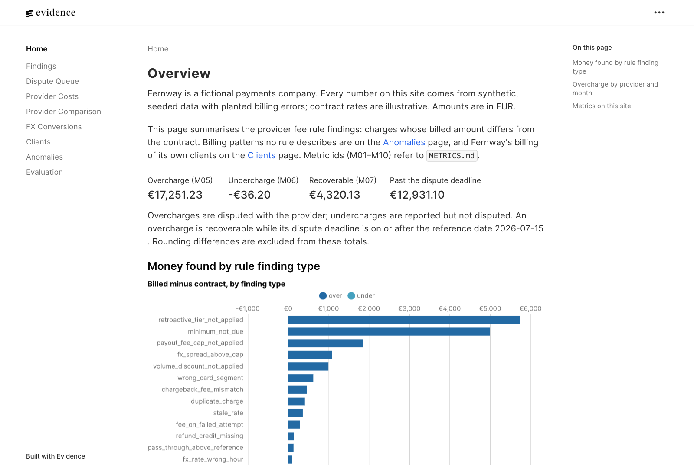

# payments-fee-audit

A payments company pays its providers thousands of small fees a month, each set by a contract clause with tiers, caps, amendments and rounding rules. Invoices are checked by total, not by line, so a few cents per payment leak until the dispute window closes. This project recomputes every charge from the contract and the internal ledger, reports each difference with its evidence, and writes the dispute pack.

<!-- generated:headline -->
From 2026-01 to 2026-06, 18,230 provider charges differ from the contracts: EUR 17,251.23 overcharged and EUR 36.20 undercharged. As of 2026-07-15, EUR 4,320.13 can still be disputed on 5 open invoices (M07); EUR 12,931.10 is past its dispute deadline. A further 305 one-cent rounding differences (EUR 3.05 net) are reported but not disputed.


<!-- /generated -->

Everything runs on synthetic, seeded data: Fernway, its 40 clients and its 3 providers are fictional, and the contracts and rates are illustrative. Because the data is generated, every planted billing error is known and the checks are scored against it. Every number in this file and in `docs/walkthrough.md` is written by `make report` from the warehouse; the text around the numbers is hand-written.

## See it in two minutes

<!-- generated:examples -->
- [Findings summary](reports/examples/findings_summary.md): overcharge and undercharge by provider, type and month; what can still be disputed against what is past its deadline; anomalies, reported but not disputed.
- [Follow one finding](reports/examples/follow_one_finding.md): one finding traced from the provider's raw file row through staging, the reconciliation match and the expected charge with its formula, to the finding.
- Dispute pack for invoice BP-2026-06-001: [letter](reports/examples/dispute_packs/brightpay/BP-2026-06-001/letter.md) and [line-level findings](reports/examples/dispute_packs/brightpay/BP-2026-06-001/findings.csv), clause-cited (178 overcharges, EUR 309.32, deadline 2026-08-02).
- [Client report](reports/examples/client_report.md): the same checks on Fernway's own invoices: revenue leakage by client, type and month, and margin per client.
- [Monthly provider cost report](reports/examples/provider_costs.md): volume, fees by component, effective and markup rates by provider and card segment, change against the previous month.
- [Provider comparison](reports/examples/provider_comparison.md): cost per card segment under each card contract.
<!-- /generated -->

`make site` builds an [Evidence](https://evidence.dev) site over the same tables: findings, dispute queue, provider costs and comparison, FX conversions, clients, anomalies and the evaluation.



## What it does

1. **Contracts are data.** Each provider contract is versioned YAML under `contracts/`, one clause per term: tiered markup on monthly volume, interchange passed through at cost, a blended rate per card segment, refund and chargeback fees, FX spread cap against an hourly mid rate, payout fees with a minimum and a cap, a monthly minimum. An amendment is a new version in force from a date.
2. **Provider files are messy on purpose.** Each provider's exports and invoices come in their own format and quirks: local times without an offset, major against minor units, `;`-delimited comma decimals, re-exported duplicates, late lines in next month's file, lines without a reference. Staging types them into one canonical model and the evaluation checks that none of this noise ever becomes a finding.
3. **Every line is matched, priced and compared.** A provider line is reconciled to a ledger event (by reference, then one-to-one by amount, currency, client and time), priced under the contract version in force, and compared to the cent. A difference becomes a typed finding with its formula and `file:row` evidence. Duplicates, charges with no matching payment and lines after the ledger watermark get their own status rather than a guess.
4. **Findings become finance outputs.** A findings summary by provider, type and month; a dispute queue per invoice with its deadline; a dispute pack per invoice (letter plus line-level CSV); a monthly cost report; a provider comparison per card segment.
5. **The same engine runs on the revenue side.** Each client's pricing agreement is applied to the client's events and compared with the invoice Fernway sent: a fee not billed, a promotion past its end date, a discount above the agreed tier. Margin per client sets the billing against the provider costs of the client's own events.
6. **What no rule describes is still reported.** A second pass flags a fee type the provider never billed before and a daily effective rate that moves off its baseline, states what explains it, and claims no money.
7. **Contracts can arrive as prose.** Every provider contract version is also rendered as legal text, and an LLM turns it back into contract YAML under a JSON schema. Every extracted term is `approved: false`, the loader refuses unapproved terms, and a spend ledger refuses any call that could exceed the budget.

## What the numbers prove, and what they don't

Precision and recall are 1.000 on every planted error type. That is expected, not impressive: the generator and the engine read the same contract files. What the harness does prove, and `make all` fails if any of it stops being true: zero findings on the eight kinds of file noise above; a Python reference engine, written separately from the SQL, agrees with the dbt models on every expected charge to the cent; the committed README, examples and chart are byte-identical to a fresh build. What it does not prove is behaviour on real contracts and real provider files. The full tables, the anomaly detail and the extraction scores are in [docs/walkthrough.md](docs/walkthrough.md).

## How it's built

dbt on DuckDB (41 models, 9 invariant tests), a Python reference engine with a differential check, an evaluation step against the planted truth, report generation and an Evidence site. [docs/walkthrough.md](docs/walkthrough.md) walks through one clause in its three forms (YAML, SQL, Python), the model lineage, the reconciliation statuses and how each kind of noise is handled; [docs/data-contract.md](docs/data-contract.md) is the binding semantics of every source, term and finding type.

The repository was built in nine phases, each a pull request, with coding agents doing the implementation from a written design. The design, the numbered assumptions ([ASSUMPTIONS.md](ASSUMPTIONS.md)), the data contract, the review of every phase and the provenance of every number in this file are the author's; the build and CI exist so that none of it has to be taken on trust.

## Limits and next steps

- **Illustrative rates.** The interchange and scheme fee table and every contract are made up, realistic in shape and order of magnitude only. Real interchange depends on far more than scheme, card type and region.
- **Synthetic benchmark.** The FX mid series is a seeded random walk standing in for a published reference rate; a real deployment would load the provider's stated benchmark.
- **Planted errors are the errors we thought of.** Precision and recall are measured against what the generator planted. The anomaly model is there for what no rule describes, and it reports, rather than claims, money.
- **Batch, not streaming.** Everything is recomputed from files after the month closes; checking charges as settlement lines arrive would shorten the time to dispute.
- **One acquirer contract shape each.** Real contracts add scheme-specific markups, cross-border surcharges, VAT and minimum-term clauses that the term kinds here do not cover.

## Reproduce

Requires Python 3.12.

```bash
python -m venv .venv && .venv/bin/pip install -r requirements.txt -r requirements-dev.txt
make all     # clean, contracts, data, build, verify, eval, extraction-score, report
make test
```

`make all` takes a couple of minutes on a laptop and needs no network access. CI runs the same and fails if the committed examples, this README or the walkthrough differ from what the build writes.

### Report site

Requires Node.js 20 or later with npm 11 (the lock file is in npm 11 format) and a warehouse built by `make all`.

```bash
make site                 # npm ci, extract the marts to site/sources, build the static site into site/build
cd site && npm run preview  # serve the build locally; or `npm run dev` for live editing
```

### Repository map

| Path | Contents |
|---|---|
| `config/generator.yml` | Seed and parameters of the synthetic world |
| `generator/` | Writes the ledger, provider exports, invoices and the planted truth (`make data`) |
| `contracts/` | Provider and client contracts as versioned YAML, validated by `feeaudit/contract_schema.json` |
| `dbt/models/` | Staging, reconciliation, expected charges, findings and marts (`make build`) |
| `feeaudit/reference/` | Python reference engine for the differential check (`make verify`) |
| `feeaudit/evaluation/` | Scores the findings against the planted truth (`make eval`) |
| `feeaudit/reports/` | Finance outputs, the generated blocks of this file and the walkthrough, and the headline chart (`make report`) |
| `feeaudit/extraction/`, `contracts/text/`, `contracts/extracted/` | LLM contract extraction, the prose it reads and its recorded output (`make extraction-score`) |
| `site/` | Evidence report site on the marts and the evaluation (`make site`) |
| `docs/walkthrough.md` | The long version: world, lineage, reconciliation, findings, evaluation, anomalies, revenue side, extraction |
| `docs/data-contract.md` | Binding semantics of every source, term and finding type |
| `ASSUMPTIONS.md`, `METRICS.md` | Numbered assumptions and metric definitions |
| `tests/` | Unit and integration tests (`make test`) |
